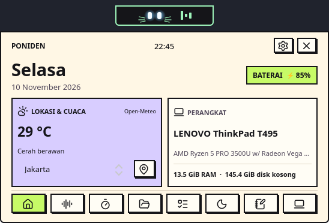
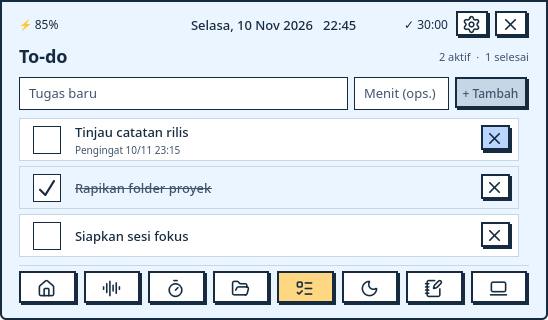
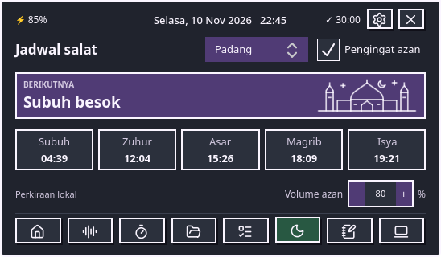

# Poniden by utidev

Notch desktop untuk **CachyOS dan KDE Plasma 6 di Wayland**. Wajah kucing hitam melirik dan berkedip saat idle. Saat audio diputar, indikator kecil muncul di sampingnya. Arahkan kursor ke notch untuk melihat jam dan baterai, lalu klik untuk membuka Beranda.

[Unduh rilis terbaru](https://github.com/azlan07/Poniden/releases/latest) · [Lisensi MIT](LICENSE)

## Preview



<details>
<summary>Lihat tab To-do dan Salat</summary>





</details>

## Fitur

- **Beranda** menampilkan tanggal Indonesia, baterai, cuaca, dan ringkasan perangkat. Tab **Sistem** menampilkan penggunaan CPU, RAM, disk, jaringan, suhu, model perangkat, kernel, dan waktu aktif.
- **Media, Fokus, Shelf, To-do, dan Catatan** menyediakan kontrol playback lewat MPRIS, Pomodoro, referensi file drag-and-drop, tugas dengan pengingat opsional, dan catatan lokal.
- **Salat** menghitung perkiraan jadwal offline, termasuk untuk Padang. Pengingat azan dapat diaktifkan dari tab Salat. Alarm Fokus dan azan punya volume 0–100% masing-masing.
- **Pengaturan** menyediakan empat palet neubrutalism, ukuran notch, animasi, dan auto-hide. Saat aplikasi dimaksimalkan atau fullscreen, pengingat Fokus dan Salat tetap bisa tampil.
- **Lokasi cuaca** bisa dipilih terpisah dari kota salat. Beranda mengambil cuaca dari [Open-Meteo](https://open-meteo.com/). Tombol pin melakukan perkiraan kota lewat [ipapi.co](https://ipapi.co/) hanya saat diklik.

## Menjalankan di CachyOS

Poniden membutuhkan KDE Plasma 6 di Wayland, Python 3, PySide6/Qt 6.12 atau lebih baru, LayerShellQt, dan PipeWire. Pada CachyOS yang sudah diperbarui, pasang dependensinya dengan:

```bash
sudo pacman -S --needed pyside6 layer-shell-qt plasma-workspace plasma-pa pipewire-audio qt6-svg
```

Unduh **Source code (zip)** dari halaman rilis, ekstrak, buka terminal di folder hasil ekstrak, lalu jalankan:

```bash
bash poni.sh
```

Alternatifnya, ambil versi pengembangan dengan `git clone https://github.com/azlan07/Poniden.git`, lalu jalankan `bash poni.sh` dari direktori repo.

Untuk autostart, pilih **Jalankan saat masuk KDE** dari menu tray. Sebelum mengganti versi, pilih **Keluar** di tray lalu jalankan launcher versi baru. Preferensi, tugas, dan catatan disimpan per pengguna melalui QSettings.

## Kredit dan lisensi

Dikembangkan oleh **utidev**. Poniden tumbuh dari sesi prototyping dan percakapan dengan **GPT-6.1 Sol**, lalu bentuk dan perilakunya disempurnakan lewat uji langsung di CachyOS.

Kode Poniden tersedia dengan [Lisensi MIT](LICENSE). Rekaman alarm dan azan punya lisensi Creative Commons masing-masing, dengan sumber dan atribusi di [Kredit audio](AUDIO.md). Ikon navigasi berasal dari [Lucide](https://lucide.dev/icons/) dan memakai [lisensi ikon](icons/LICENSE) tersendiri.
